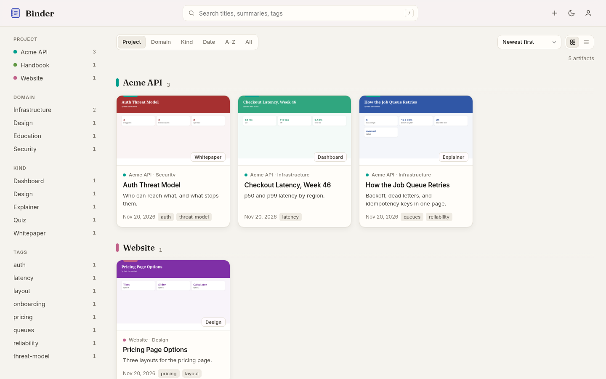
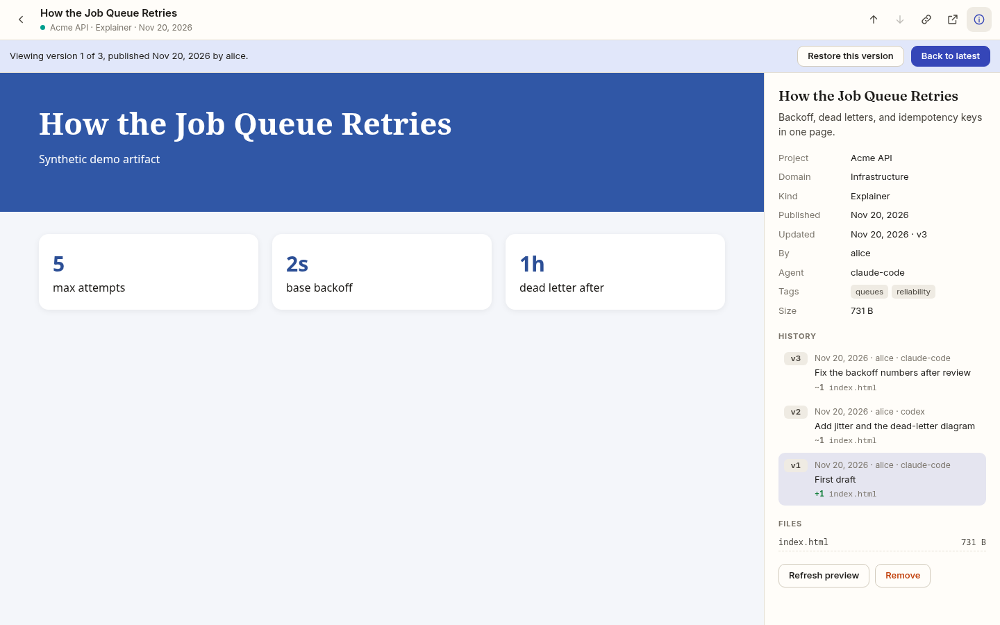

# Binder

A small, self-hosted library for the pages your AI agents build.

Agents make a lot of things that are not code: interactive explainers, diagrams, dashboards, quizzes, design options, reports. They are usually one HTML file, sometimes a folder, and they end up scattered across threads, machines, and temp folders. Binder gives them one home. An agent publishes with one HTTP request. Binder files the page by project and kind, keeps every version, and shows it in a sandboxed viewer that you and your team can browse.



## What it does

- **One request to publish.** Any agent that can run `curl` can publish. No SDK, no MCP server, no install on the agent's machine. A drop-in [agent skill](skill/binder/SKILL.md) tells agents how, and every Binder serves the same steps at `/llms.txt`.
- **Every version kept.** Publishing the same `id` again makes a new version. The history shows who published each one, when, their note, and which files changed. Open any old version, restore it, or download it (one file as itself, several files as a zip).
- **Find things again.** Group by project, domain, kind, date, or title. Filter, search, and share a filtered view as a link.
- **Untrusted HTML stays in its box.** Every page runs in a sandboxed, opaque origin. It cannot read Binder, your session, or other pages, and it cannot publish or delete anything.
- **Small.** One Bun process, one SQLite file, one data folder. No runtime dependencies and no build step.



## Quick start

You need Docker.

```sh
git clone https://github.com/pb3975/binder && cd binder
docker compose up -d
docker compose exec binder binder token create --name you
```

Open <http://localhost:8480> and paste the token. Then publish something:

```sh
export BINDER_URL=http://localhost:8480 BINDER_TOKEN=bnd_...   # make a separate token per agent
echo '<h1>Hello, Binder</h1>' > hello.html
curl -fsS "$BINDER_URL/api/artifacts" -H 'X-Binder: 1' -H "Authorization: Bearer $BINDER_TOKEN" \
  -F 'meta={"id":"hello","title":"Hello","project":"demo","note":"First version"}' \
  -F 'file=@hello.html'
```

Run the same command again with new content and a new `note` to see version history. To give an agent the same ability, copy [`skill/binder/`](skill/binder/) into its skills folder and set `BINDER_URL` and `BINDER_TOKEN` in its environment. Or tell an agent to read `http://localhost:8480/llms.txt`.

## Run it for a team

- **Tokens.** Each person and each agent gets a named token (`binder token create --name alice`, `--scope read` for read-only). History records who published each version. Revoking a token ends its browser sessions too.
- **Single sign-on through a proxy.** Behind Tailscale or another identity-aware proxy, Binder can trust the proxy's user header. It accepts the header only from the proxy's address and only for allowed logins.
- **Anywhere.** Docker Compose, plain `docker run`, bare Bun, or a cloud container host. [`fly.toml`](fly.toml) is a Fly.io example, and [docs/aws.md](docs/aws.md) deploys a private Binder on AWS (ECS Fargate and S3) with the CDK. Neither is deployed by CI yet.
- **Previews.** The default image is small and shows a generated cover for each page. The `full` image renders preview images with Chromium. Use it when you trust your publishers. [Why](docs/design.md#previews).

Everything is in [docs/self-hosting.md](docs/self-hosting.md).

## Publish API

`POST /api/artifacts` with `multipart/form-data`:

- `meta`: JSON with `title`, and optionally `id` (a stable slug; reuse it for a new version), `note`, `summary`, `project`, `domain`, `kind`, `tags`, `source_url` (http or https), `published_at`, `agent`, `host`, `entry`.
- `file`: one part per file. A single HTML file becomes `index.html`. For a folder, set each part's filename to its relative path.
- Headers: `X-Binder: 1` on every write, and `Authorization: Bearer <token>` unless a trusted proxy identifies you.

The response includes `url` (the viewer link), `version`, and `content_url` (a signed link to this version's files).

Other routes: `GET /api/artifacts`, `GET|PATCH|DELETE /api/artifacts/:id`, `GET /api/artifacts/:id/versions`, `POST /api/artifacts/:id/versions/:n/restore`, `GET /api/artifacts/:id[/versions/:n]/download`, `POST /api/artifacts/:id/thumbnail`, `GET|POST|DELETE /api/session`, `GET /c/...` (signed content), `GET /raw/:id/<path>` (redirects to signed content), `GET /thumb/:id.png`, `GET /healthz`, `GET /llms.txt` (these publish instructions for agents, with the instance's URL filled in).

This is API v1. Changes inside v1 are additive only.

## How it stays safe

- Artifact files are served only from signed URLs that grant read access to one version for a few hours. They carry `Content-Security-Policy: sandbox`, so a page runs in an opaque origin with no access to Binder.
- Writes need an `X-Binder: 1` header. A sandboxed page can only send that after a CORS preflight, which Binder never approves.
- Binder's own pages have a strict CSP, and publisher metadata is always rendered as text.
- Preview rendering, when on, uses a pinned wrapper page, a CDN-only CSP, and a network allowlist. CI throws 21 attacks at it and expects zero connections.

The full threat model is in [docs/design.md](docs/design.md). Report a vulnerability as described in [SECURITY.md](SECURITY.md).

## Develop

```sh
bun install
bun run dev        # http://localhost:8480, auth off, data in ./data
bun run check      # types and tests
scripts/e2e.sh     # real container and real Chromium
```

See [docs/development.md](docs/development.md) and [CONTRIBUTING.md](CONTRIBUTING.md). Decisions and their reasons are in [docs/decisions.md](docs/decisions.md).

## License

[MIT](LICENSE).
