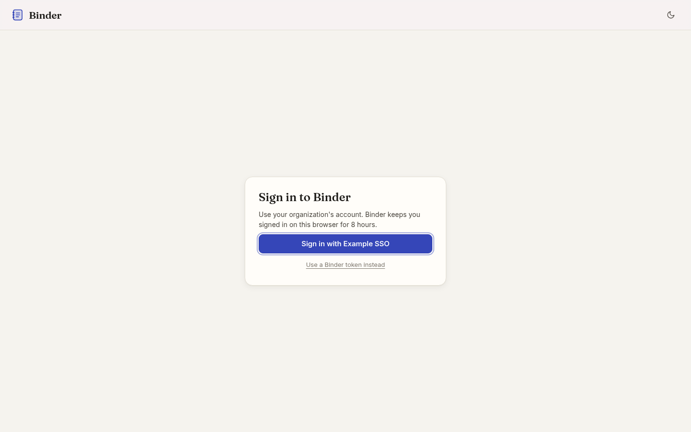

# Self-hosting Binder

Binder is one process with one data folder. It runs anywhere Docker or [Bun](https://bun.sh) runs. CI tests `linux/amd64`; the image is built for `linux/arm64` too, and CI starts testing it once the repository is public.

## Quick start (Docker Compose)

```sh
git clone https://github.com/pb3975/binder && cd binder
docker compose up -d
docker compose exec binder binder token create --name you
```

1. Copy the `bnd_...` token that the last command prints. Binder shows it only once.
2. Open <http://localhost:8480> and paste the token.
3. Give an agent the same kind of token (`binder token create --name my-agent`) and the skill in [`skill/binder/SKILL.md`](../skill/binder/SKILL.md). An agent without the skill can read the same instructions at <http://localhost:8480/llms.txt>.

Compose binds Binder to `localhost` only. To share it, put HTTPS in front (see below) and set `BINDER_PUBLIC_URL`.

### On your own laptop, without tokens

If Binder is only for you, on your own machine, you can turn sign-in off:

```sh
git clone https://github.com/pb3975/binder && cd binder
bun install --production
BINDER_AUTH=none bun src/server.ts
```

Open <http://localhost:8480>. Agents on the same machine publish with `BINDER_URL=http://localhost:8480` and no token. Binder logs a warning at startup, because anyone who can reach it can read and publish. It listens on `127.0.0.1` and answers only requests addressed to `localhost`, `127.0.0.1`, or `[::1]` (see [None](#none-your-own-machine-only)). Never use `none` with `HOST=0.0.0.0` on a shared network or on a server.

## Images

| Target | Build | What you get |
|---|---|---|
| `slim` (default) | `docker build -t binder .` | No Chromium. Cards show a generated cover. About 130 MB. |
| `full` | `docker build --target full -t binder:full .` | Preview images rendered by Chromium. About 1.3 GB. |

Choose `full` only if you trust the people and agents who publish. Chromium cannot use its own sandbox inside an unprivileged container, so a Chromium bug in a published page would reach the container. Binder still renders every preview through a pinned wrapper, a CDN-only CSP, and a network allowlist; see [design.md](design.md#previews). To switch Compose to `full`, set `target: full` in `docker-compose.yml`.

The container starts as root only long enough to give `/data` to the unprivileged `bun` user, then drops to it. To match a host folder's owner instead, pass `--user <uid>:<gid>`; the folder must already belong to that user.

## Bare Bun

```sh
bun install --production
bun run binder token create --name you
BINDER_DATA_DIR=/var/lib/binder bun src/server.ts
```

Install Chromium for previews, or set `BINDER_PREVIEWS=off`. Run it under systemd, launchd, or any process manager. It listens on `127.0.0.1:8480` by default.

## Fly.io

[`fly.toml`](../fly.toml) is an example with HTTPS, one volume, and the health check. It has not been deployed by CI; please report anything that needs changing.

```sh
fly launch --no-deploy --copy-config --name <your-app>
fly volumes create binder_data --size 1 --region <region>
fly deploy
fly ssh console -C "binder token create --name you"
```

Set `BINDER_PUBLIC_URL` in `fly.toml` to your app's URL. Fly stops idle machines and starts them on the next request. Binder is one process with SQLite, so keep it to one machine (`fly scale count 1`). The same pattern works on any container host that gives you one persistent volume, such as Railway, Render, or a VM.

## HTTPS

Binder speaks plain HTTP. Put it behind something that adds TLS: Caddy (`reverse_proxy 127.0.0.1:8480`), nginx, Traefik, Cloudflare Tunnel, a cloud load balancer, or `tailscale serve`. Then set `BINDER_PUBLIC_URL` to the HTTPS URL, so links in API responses are right and session cookies get the `Secure` flag.

## Backup and upgrades

- Everything lives in the data folder. Back it up with any file copy while Binder is stopped, or use `sqlite3 binder.sqlite ".backup ..."` plus a copy of `versions/` while it runs.
- Binder upgrades the database schema on start. **Back up before upgrading**, because an older Binder cannot read a newer schema and refuses to start on one.
- Run one Binder process per data folder.

## Configuration

Binder reads all configuration from environment variables. Every variable is optional.

| Variable | Default | What it does |
|---|---|---|
| `BINDER_DATA_DIR` | `./data` (`/data` in the image) | Where the database, the signing key, and every version's files live. Back up this folder. |
| `HOST` | `127.0.0.1` (`0.0.0.0` in the image) | Address to listen on. |
| `PORT` | `8480` | Port to listen on. |
| `BINDER_PUBLIC_URL` | the request's origin | The URL people use, such as `https://binder.example.com`. Set it behind a TLS proxy so returned links are right. It must be an `http` or `https` origin with no path: Binder does not support hosting under a subpath such as `/binder`. |
| `BINDER_PREVIEWS` | `auto` | `auto` renders previews when Chromium is found. `on` requires Chromium. `off` never starts Chromium. |
| `CHROMIUM` | `/usr/bin/chromium-browser` or `/usr/bin/chromium` | Chromium binary for previews. |
| `BINDER_PREVIEW_HOSTS` | common public CDNs (cdnjs, jsDelivr, unpkg, esm.sh, Tailwind, jQuery, Google Fonts) | Comma list of the only external hosts a page may load from while its preview renders. `*.example.com` works. Viewing in a browser is not limited. |
| `BINDER_AUTH` | `token` | How people sign in: `token`, `none`, `oidc`, or `header`. See [Who can get in](#who-can-get-in). If it is unset and `BINDER_AUTH_HEADER` is set, the mode is `header`. |
| `BINDER_AUTH_HEADER` | unset | Header mode: trust this request header to name the user, such as `Tailscale-User-Login`. Required with `BINDER_AUTH=header`, and refused with any other mode. |
| `BINDER_ALLOWED_USERS` | unset | Header and oidc modes. Comma list of logins or emails, `*@example.com`, or `*`. Required in header mode. |
| `BINDER_TRUSTED_PROXIES` | `127.0.0.1,::1` | Header mode only. Peer addresses (IPs or IPv4 CIDRs) the header is accepted from. |
| `BINDER_OIDC_ISSUER` | unset | Oidc mode, required. The provider's issuer URL, exactly as its discovery document says it. |
| `BINDER_OIDC_CLIENT_ID` | unset | Oidc mode, required. The client ID you registered for Binder. |
| `BINDER_OIDC_CLIENT_SECRET` | unset | Oidc mode. Set it for a confidential client (`client_secret_basic`). Leave it unset for a public client, which uses PKCE only. |
| `BINDER_OIDC_SCOPES` | `openid email profile` | Oidc mode. Scopes to ask for. Must include `openid`. |
| `BINDER_OIDC_LABEL` | `Sign in with SSO` | Oidc mode. Text on the sign-in button. |
| `BINDER_ALLOWED_GROUPS` | unset | Oidc mode. Comma list of groups. A member of any of them may sign in. Oidc mode needs this, `BINDER_ALLOWED_USERS`, or both. |
| `BINDER_OIDC_GROUPS_CLAIM` | `groups` | Oidc mode. The ID token claim that lists the person's groups. |
| `BINDER_OIDC_SIGNING_ALG` | `RS256` | Oidc mode. The one ID token signature algorithm Binder accepts: `RS256`, `PS256`, or `ES256`. Match your provider's setting. |
| `BINDER_OIDC_HOSTED_DOMAIN` | unset | Oidc mode, for Google Workspace. The signed `hd` claim must equal this domain. |
| `BINDER_OIDC_ALLOW_HTTP` | `false` | Oidc mode, **tests only**. `true` allows plain http to a provider that is not on `localhost`, as on an isolated Docker test network. Never set it in production. |

Oidc mode also needs `BINDER_PUBLIC_URL`, because the redirect URI is `${BINDER_PUBLIC_URL}/auth/callback`. Binder never builds it from the request. The issuer, every endpoint the provider's discovery document names, and `BINDER_PUBLIC_URL` must be `https`. Plain `http` works only for `localhost`, `127.0.0.1`, and `[::1]`, or with `BINDER_OIDC_ALLOW_HTTP=true`.

A setting that belongs to another mode stops startup, so a policy you meant to apply is never silently ignored. For example, `BINDER_ALLOWED_GROUPS` with `BINDER_AUTH=none` fails, and so does `BINDER_TRUSTED_PROXIES` outside header mode. A blank `BINDER_AUTH=` fails too; unset it to get the default.

Old names fail loudly, so auth never changes silently. Binder refuses to start when it sees `ALLOWED_LOGINS` or `DEV_ALLOW_ANONYMOUS` (from Binder 0.1), or `BINDER_DEV_ANONYMOUS` (replaced by `BINDER_AUTH=none`).

## Who can get in

`BINDER_AUTH` picks how people sign in. Agents always use tokens: `Authorization: Bearer bnd_...` works in every mode. Binder never stores a password. In oidc mode, your identity provider handles passwords and MFA.

| Mode | People sign in with | Use it when |
|---|---|---|
| `token` (default) | A token they paste once | A few people, no single sign-on. The simplest setup that is safe on a network. |
| `none` | Nothing | Binder runs on your own laptop, for you alone. Never on a shared network or a server. |
| `oidc` | Your identity provider: Keycloak, Okta, Entra ID, Google, Authentik, and others | A team with single sign-on. Removing someone at the provider ends their Binder session within 8 hours. |
| `header` | A proxy that signs them in, such as Tailscale | Binder sits behind `tailscale serve` or an identity-aware proxy that is the only way in. |

### Tokens (default)

Each person and each agent gets a named token. Tokens have a scope: `write` (publish, edit, remove, restore) or `read`.

```sh
binder token create --name alice              # prints bnd_..., shown once
binder token create --name ci-bot --scope read
binder token list
binder token revoke alice                     # also ends alice's browser sessions
```

Run these where the data folder is: `docker compose exec binder binder token create --name alice`, `fly ssh console -C "binder token create --name alice"`, or `bun run binder token create --name alice` for bare Bun. There is no HTTP API for tokens. Whoever can run commands on the server is the admin.

- Agents send `Authorization: Bearer <token>`.
- People paste their token once on the sign-in screen. Binder sets a 30-day session cookie (`HttpOnly`, `SameSite=Strict`) and never stores the token in the browser.
- Binder stores only a SHA-256 hash of each token.
- Serve Binder over HTTPS whenever tokens cross a network you do not trust.

### None (your own machine only)

`BINDER_AUTH=none` treats every request without a token as the user `anonymous`, who can read and write. A valid token still names the publisher, and writes still need `X-Binder: 1`.

A web page you visit could try to reach Binder on `localhost` through DNS rebinding: its own domain name starts to resolve to `127.0.0.1`. Its requests still carry that domain in the `Host` header. So in none mode, Binder answers only when `Host` is `localhost`, `127.0.0.1`, `[::1]` (any port), or the host of `BINDER_PUBLIC_URL`. Every other request gets `421` with a message. This covers the UI, the API, and `/c/` content. `/healthz` always answers.

### OIDC (single sign-on)



Binder signs people in with the OpenID Connect authorization code flow, with PKCE (S256), `state`, and `nonce`. It verifies the ID token itself: one signature algorithm (`BINDER_OIDC_SIGNING_ALG`, RS256 by default), keys from the provider's JWKS, and exact `iss`, `aud`, `sub`, `exp`, `iat`, and `nonce` checks. The audience must be Binder's client ID alone; a token also meant for another audience is refused. Binder refuses an email the provider marks as not verified (`email_verified: false`).

```sh
BINDER_AUTH=oidc
BINDER_PUBLIC_URL=https://binder.example.com
BINDER_OIDC_ISSUER=https://id.example.com/realms/team
BINDER_OIDC_CLIENT_ID=binder
BINDER_OIDC_CLIENT_SECRET=...            # from the provider; keep it out of git
BINDER_ALLOWED_GROUPS=binder-users       # and/or BINDER_ALLOWED_USERS='*@example.com'
BINDER_OIDC_LABEL='Sign in with Example'
```

1. Register Binder at your provider as a web application. The redirect URI is `https://binder.example.com/auth/callback`: your `BINDER_PUBLIC_URL` plus `/auth/callback`.
2. Open Binder at `BINDER_PUBLIC_URL`. The sign-in cookie is set on that address, so sign-in from another address fails with "took too long".
3. The person's Binder name is the `email` claim, in lowercase. If there is no email, Binder uses `preferred_username` and matches the allowlist against that.
4. The SSO session lasts 8 hours. Then the person sees the sign-in screen again. The provider usually signs them in again without asking for a password. Changing the provider, the client, either allowlist, or `BINDER_OIDC_HOSTED_DOMAIN` ends every SSO session at the next start.
   - Removing someone at the provider ends their Binder session within 8 hours. Content links they already opened are separate: each signed `/c/` link lasts 8 to 9 hours from when Binder issued it. So a link issued just before the session ended can keep working for up to 9 more hours. Removing an artifact ends its links at once.
5. Two tabs can sign in at once. Each sign-in has its own short-lived cookie (10 minutes). A sign-in that is still at the provider when Binder restarts still finishes, but Binder forgets which sign-ins it has finished, so the provider's one-time code is then the only guard against a replay.
6. Sign out ends the Binder session only. The person stays signed in at the provider.
7. Tokens keep working. People can still paste a token on the sign-in screen under "Use a Binder token instead", and agents publish with tokens.

#### Keycloak

1. In your realm, go to **Clients**, then **Create client**. Use client type **OpenID Connect** and client ID `binder`.
2. Turn **Client authentication** on (a confidential client). Under **Authentication flow**, keep **Standard flow** only.
3. Set **Valid redirect URIs** to `https://binder.example.com/auth/callback` and **Web origins** to `https://binder.example.com`.
4. On the **Credentials** tab, copy the client secret into `BINDER_OIDC_CLIENT_SECRET`.
5. To allow a group: on the client's **Client scopes** tab, open `binder-dedicated` and add a mapper **By configuration**, **Group Membership**. Set **Token Claim Name** to `groups`, turn **Full group path** off, and keep **Add to ID token** on. Then set `BINDER_ALLOWED_GROUPS` to the group name, such as `binder-users`.
6. Set `BINDER_OIDC_ISSUER` to `https://<keycloak host>/realms/<realm>`.
7. Binder refuses a user whose email is not verified (`email_verified: false`), even when the user is in the group. Verify each user's email in Keycloak (**Users**, then **Email verified**), or turn on **Verify email** for the realm.

With **Full group path** on, the claim says `/binder-users`, and Binder compares group names exactly. CI signs in through a real Keycloak with the realm in [`test/e2e/keycloak-realm.json`](../test/e2e/keycloak-realm.json) (`scripts/e2e-oidc.sh`).

#### Other providers

CI tests Keycloak only. These notes are not tested, and providers change their consoles, so check each against your provider's documentation and its `/.well-known/openid-configuration`.

- **Okta.** Issuer: `https://<your-org>.okta.com/oauth2/default` for the default authorization server, or `https://<your-org>.okta.com` for the org server. Create an OIDC **Web Application**. For groups, add a `groups` claim to the ID token in the authorization server's **Claims** (with a filter such as "Matches regex `.*`"), or on the org server, set the app's **Groups claim**.
- **Microsoft Entra ID.** Issuer: `https://login.microsoftonline.com/<tenant-id>/v2.0`. Register an app with a **Web** redirect URI. **Allow by group, not by email domain.** Entra does not send `email_verified`, and a user or a guest can have an `email` or `preferred_username` in a domain your tenant does not own, so `BINDER_ALLOWED_USERS='*@your-domain'` is not safe here. Turn on the groups claim under **Token configuration**, **Add groups claim**. It holds group object IDs (GUIDs), not names, so put the IDs in `BINDER_ALLOWED_GROUPS`. Exact emails of known people are fine too.
- **Google.** Issuer: `https://accounts.google.com`. Create an OAuth client of type **Web application**. Google sends no groups claim. To admit a Google Workspace domain, set `BINDER_OIDC_HOSTED_DOMAIN=example.com` and `BINDER_ALLOWED_USERS='*'`: Google signs the account's Workspace domain into the `hd` claim, and Binder requires it to match. Do not use `*@example.com` alone with Google, because an email suffix does not prove the account belongs to that Workspace. For a few people, list their exact emails.
- **Authentik, Zitadel, Auth0, and others.** Use the issuer URL that the provider's `/.well-known/openid-configuration` reports. Binder refuses to start sign-in when the discovered issuer differs from `BINDER_OIDC_ISSUER`, even by a trailing slash.

If sign-in fails, Binder logs the reason (`sign-in refused (...)`) and shows the person a short message.

### Header mode (Tailscale or an identity-aware proxy)

A proxy that signs people in can tell Binder who they are in a header. Binder trusts that header only when all of these are true:

1. `BINDER_AUTH_HEADER` names it.
2. The request comes from an address in `BINDER_TRUSTED_PROXIES`.
3. The login matches `BINDER_ALLOWED_USERS`.

Otherwise Binder ignores the header and logs a warning. Header logins can write. Tokens still work in header mode, so agents outside the proxy can publish.

**The proxy must be the only way to reach Binder,** and it must overwrite the header on every request. If anything else can reach the port from a trusted address, it can claim to be anyone.

#### Tailscale

`tailscale serve` adds `Tailscale-User-Login` for tailnet users and is reachable only on your tailnet.

```sh
docker run -d --name binder --restart unless-stopped \
  -p 127.0.0.1:8480:8480 -v binder-data:/data \
  -e BINDER_AUTH_HEADER=Tailscale-User-Login \
  -e BINDER_ALLOWED_USERS='you@example.com' \
  -e BINDER_TRUSTED_PROXIES="$(docker network inspect bridge -f '{{(index .IPAM.Config 0).Gateway}}')" \
  -e BINDER_PUBLIC_URL=https://<machine>.<tailnet>.ts.net:8480 \
  binder
tailscale serve --bg --https=8480 http://127.0.0.1:8480
```

Through a Docker port mapping, the container sees the bridge gateway (often `172.17.0.1`) as the peer, not `127.0.0.1`. That is why the example sets `BINDER_TRUSTED_PROXIES`. If sign-in fails, `docker logs binder` shows the address Binder saw.

#### Other proxies (recipe, not tested in CI)

oauth2-proxy, Authelia, Pomerium, and Cloudflare Access can pass a user header too. Two rules make them safe with Binder:

- Let `/c/` and `/render/` through without the proxy's login. A sandboxed artifact's requests for its own images and scripts carry no cookies, so a cookie-based proxy would block them. Binder checks a signature on these URLs itself.
- Let requests with an `Authorization: Bearer` header through to Binder, so agents can publish with tokens.

If your proxy cannot do both, use tokens only.
